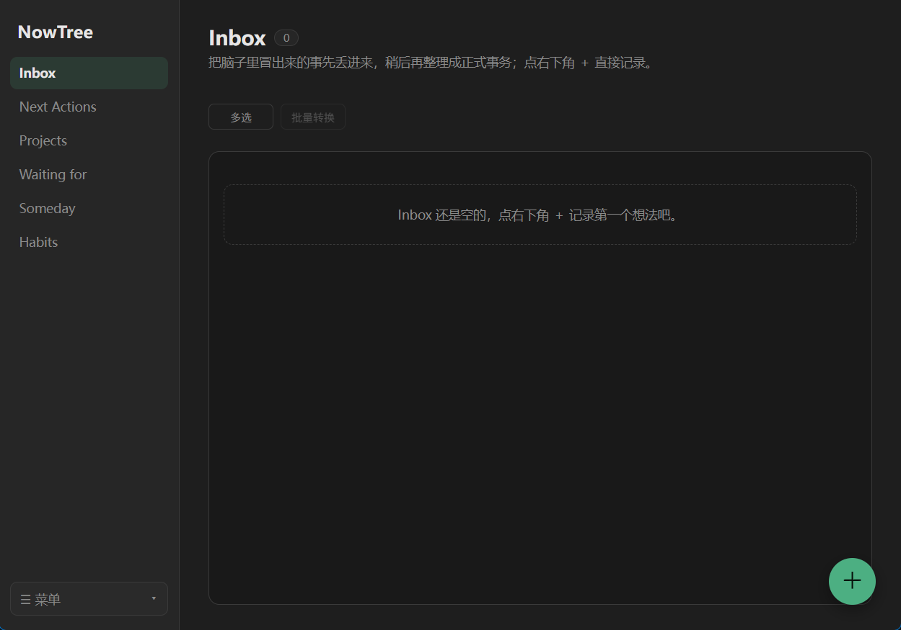
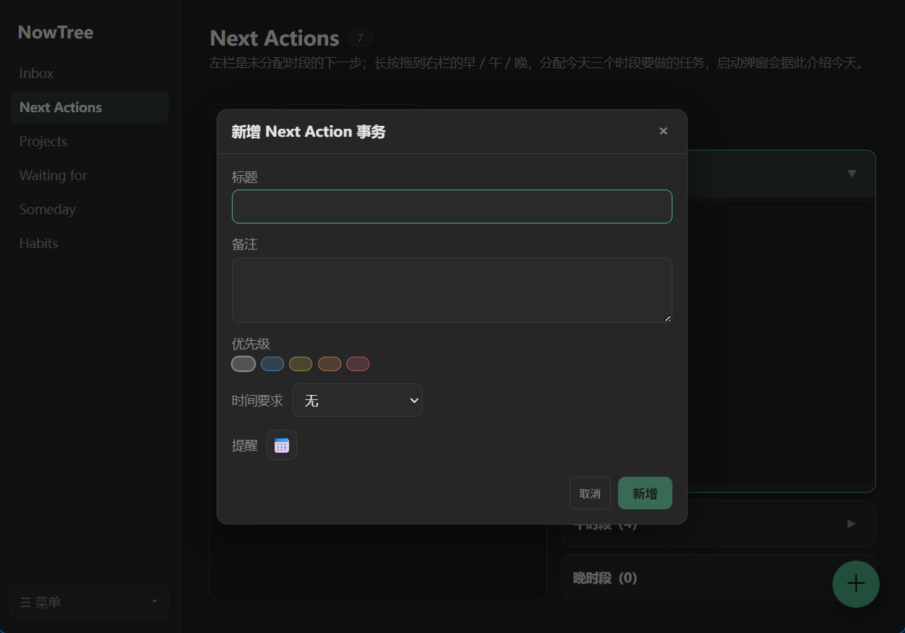

# NowTree

**NowTree 是一个 Windows 桌面上的个人事务管理工具，数据只存在你自己的电脑里：不用注册，平时也不用联网。**

用法一句话说完：**想到什么先扔进「收集箱」，不用当场想清楚；有空时回看，把每条整理成「下一步要做的事」，按早／午／晚排进今天，做完勾掉。**

左侧一共就五个视图：「收集箱」是入口，还没想清楚的全攒这儿；回看时把每条整理进四个去处之一——「下一步」是能立刻动手的事，「项目」是要拆好几步的事，「等待他人」是等别人回复的，「将来也许」是暂时不做的。这套「先捕获、再整理成下一步」的思路，就是 GTD（Getting Things Done）。

> 种一棵树最好的时间是十年前，其次是现在。

---

## 快速上手

1. **装** —— 从 [Releases](https://github.com/z1lyA/NowTree/releases/latest) 下载最新的 `NowTree_<版本>_x64-setup.exe`，双击安装后打开（仅 Windows 10/11）。
2. **记** —— 按 `Enter` 写下脑子里的第一条，它会先躺在「收集箱」里，不用当场想清楚。
3. **排** —— 有空时回看，把它整理成「下一步」，选好早／午／晚时段；到点屏幕右下角会弹卡片催你，做完直接勾掉。

之后就这一个循环：**随手记 → 定期整理 → 到点提醒 → 勾掉**。每天开机或跨时段时，右下角还会推一张当日摘要卡，告诉你这个时段该做什么。

---

## 界面截图

| 收集箱 | 新增事务 |
|---|---|
|  |  |

> 截图为深色主题；浅色主题可在「设置」里一键切换。

---

## 怎么用

### 一、先记下来，别想

打开就能用，不需要建项目、选分类、填优先级。按 `Enter` 写标题（可附带备注），回车，它进「收集箱」了。它的唯一职责是**让你先别想清楚**——脑子清空了，才能专心做手上的事。

### 二、空闲时回看，把每条整理成「下一步」

回看收集箱，对每条只问一句：**下一步具体做什么？** 然后原地转成四类之一（不新建记录、不留重复）：

| 去处 | 什么情况放这里 |
|---|---|
| **下一步** | 能立刻动手做完的事 |
| **项目** | 要好几步才能完成的事，可继续拆成子事务 |
| **等待他人** | 卡在别人身上、等回复的事 |
| **将来也许** | 现在不做，但将来可能想做的事 |

项目里的子事务可以手动「加入 Next」，进入全局的下一步列表——长期目标就是这么被拆成今天能动手的一步。

### 三、按早 / 午 / 晚推进今天

「下一步」视图按今天要做什么来组织，并用**早 / 午 / 晚**三个时段把一天分段。每件事排进某个时段后：

- **到点提醒**：给事务设提醒时间，到点屏幕右下角弹出无边框置顶卡片，可直接「完成 / 稍后 / 关闭」，主窗口数据同步刷新。
- **每日摘要卡**：开机或跨时段时推一张卡，告诉你这个时段有哪些事、今天是什么日子。深夜会显示「晚安」。

时段分界线（早 / 午 / 晚各自几点开始）可在「设置 → 时段分界线」里改，仅小时粒度，改完立即生效。

### 四、完成与回顾

做完直接勾掉——事务会在原地变灰留着，不打扰你看还剩什么。攒多了点工具栏「一键清理」统一清掉，清错了还能从提示条撤销。

删掉不要的事则走「回收站」：软删除后可单条恢复、彻底删除或清空；恢复一个父项目会连带拉回它的祖先链，不会留下孤儿。

每周留十分钟回看一遍：「收集箱」堆了多少、「项目」推没推进、「将来也许」有没有该唤醒的。

> 更细的数据流、状态机与提醒调度实现，见 [docs/ARCHITECTURE.md](docs/ARCHITECTURE.md)。

---

## 功能清单

**收集与整理**

- 快速收集：记标题 / 备注，先丢收集箱，不打断当下
- 原地整理：收集箱事务直接转成四类正式事务，不产生重复记录
- 拖拽排序：长按整条可拖动重排
- 跨视图拖拽：拖到左侧导航栏即改类别；项目内可拖拽改父
- 拖到垃圾桶即删：五个视图通用，收集箱硬删、其余软删可撤销
- 回收站：单条恢复 / 彻底删除 / 清空

**执行与推进**

- 时段规划：按早 / 午 / 晚安排一天，分界线可自定义
- 项目树：项目可拆子事务，子事务可「加入 Next」
- 到点提醒：右下角自定义卡片，可直接完成 / 稍后 / 关闭
- 每日摘要卡：启动与跨时段推送当日该时段的事务清单
- 收集箱每周回顾：默认周日提醒，可改任意一天或关闭

**桌面与外观**

- 托盘常驻：关闭窗口默认收进托盘，进程存活、提醒照常
- 开机自启动
- 深浅主题：深色 / 浅色 / 跟随系统
- 弹窗个性化：位置（四角）、宽度、「稍后」时长、显示项均可调，带测试预览
- 数据管理：一键导出 / 导入 JSON 备份，方便换机迁移
- 检查更新：左下角菜单一键比对 GitHub 上的最新版本，可下载并安装（校验签名后自动安装、装完自动重启）

> 提醒卡片的拖动、自动收起、多卡堆叠折叠、全屏排队等细节，见 [docs/ARCHITECTURE.md](docs/ARCHITECTURE.md)。

---

## 数据说明

- 数据存于本机：`C:\Users\<你>\AppData\Roaming\com.nowtree.app\nowtree.sqlite`
- **完全本地**，不上云、不同步（当前版本无云同步）
- 唯一会联网的地方是你主动点「检查更新」：只向 GitHub 请求一次版本清单，不上传任何本地数据
- 换机 / 重装前，用左侧菜单「数据管理 → 导出」备份；到新机器「导入」即可迁移
- `dev` 模式与正式版使用同一份数据库（同一 `identifier`），数据互通——但**不要同时运行两者**

---

## 快捷键

| 按键 | 作用 |
|---|---|
| `1` / `2` / `3` / `4` / `5` | 切换 收集箱 / 下一步 / 项目 / 等待他人 / 将来也许 |
| `Enter` | 非输入态下快速新增当前视图事务；弹窗内保存 |
| `Esc` | 关闭当前弹窗 |
| 长按拖拽（约 220ms） | 拖动排序 / 跨类别 / 改父；拖到屏幕底部垃圾桶即删除 |

---

## 已知限制

- **仅支持 Windows 10/11**：提醒窗口、托盘、无边框卡片等实现都按 Windows 做的，暂未适配 macOS / Linux。
- **提醒需要程序在运行**：窗口最小化到托盘时仍会提醒（窗口被系统节流时最多延迟约 1 分钟）；但「退出」程序后不再提醒，彻底退出后仍提醒需 OS 级定时，暂未实现。
- **每日摘要卡**：同一时段每天只推一次，按「设置 → 时段分界线」判定当前时段。
- **全屏应用不打扰**：全屏应用在前台时提醒先排队，退出全屏后约 2 秒内补弹。
- **提醒卡片拖拽不记忆位置**：只对本次显示有效，位置以「设置 → 弹窗个性化」的四角配置为准。
- **暂无云同步 / 手机端**：目前是纯本地桌面应用。架构已预留 Repository 接口，将来可加云端实现。
- **应用内更新从 1.1.7 起才可用**：1.1.6 及更早的安装包没有内置更新公钥，需要手动下载 1.1.7 覆盖安装一次。
- **检查更新依赖 GitHub 可访问**：网络不通时会提示原因，并给「打开发布页」兜底。注意浏览器和软件走的可能是不同代理——浏览器能打开 GitHub，不代表软件也能。

---

## Roadmap

下面按「产品目标」归纳发展路线，不是版本号流水账。后续版本遵循[语义化版本](https://semver.org/lang/zh-CN/)。

- **已完成 · GTD 核心闭环** —— 收集 → 整理 → 执行 → 回顾跑通：四类视图 + 项目树、回收站、导入导出、深浅主题、拖拽与快捷键。
- **已完成 · 产品化与桌面能力** —— 系统托盘、开机自启动、到点提醒与每日摘要卡、弹窗个性化、数据层 `sync_id` / `deleted_at` 为同步铺路、单测覆盖。
- **规划中 · 未来方向**（尚未立项，不承诺排期）
  - 移动端收集 + 云同步：手机随手记，与桌面双向同步
  - 统计视图：按完成时间聚合的日报 / 年热力图 / 连续打卡
  - AI 辅助（轻量）：对收集箱批量建议「下一步」、辅助分类，敏感数据默认不出本机

> 方向能否落地取决于使用反馈与维护精力，欢迎在 Issues 里提想法。

---

## 项目与源码

想自己编译、读源码或参与改进，看这一节；只用软件的话上面就够了。

### 技术栈

| 层 | 技术 |
|---|---|
| 桌面外壳 | **Tauri v2**（Rust） |
| 前端 | **React 18** + **TypeScript** + **Vite** |
| 状态管理 | **Zustand** |
| 本地数据库 | **SQLite**（Rust `rusqlite`） |
| 后端 | Tauri 命令（`src-tauri/src/commands.rs`） |

### 目录结构

```
NowTree/
├── reminder.html             # 右下角提醒窗口入口（Vite 双入口）
├── src/                      # 前端（React + TS）
│   ├── components/           # 视图与弹窗组件
│   ├── reminder/             # 右下角提醒窗口（提醒 / 每周回顾 / 每日摘要三种卡）
│   ├── hooks/                # 拖拽、选择、生命周期等交互原语
│   ├── store/                # Zustand 全局状态
│   ├── services/             # 纯业务逻辑（类别迁移、提醒卡片、每日摘要等）
│   ├── data/                 # 数据访问层（Repository 抽象）
│   ├── types/                # 类型定义与业务常量
│   └── styles/               # 全局样式（深浅主题变量 / 提醒窗口样式）
├── docs/                     # 架构说明与截图
│   ├── ARCHITECTURE.md
│   └── screenshots/
├── src-tauri/                # 后端（Rust + Tauri）
│   ├── src/
│   │   ├── commands.rs       # Tauri 命令（增删改查 / 导入导出 / 托盘 / 窗口置顶）
│   │   ├── reminder.rs       # 提醒窗口的创建、定位、卡片投递、精确调度
│   │   ├── db.rs             # SQLite 连接、建表与 ALTER 迁移
│   │   ├── schema.sql        # 建表 DDL
│   │   └── lib.rs            # 应用入口、托盘、插件注册
│   ├── capabilities/         # 权限（main / reminder 两个窗口）
│   ├── Cargo.toml
│   └── tauri.conf.json
├── scripts/                  # 构建脚本（Windows 双击）
│   ├── run-dev.bat           # 开发热重载
│   ├── build-release.bat     # 出成品（tauri build）
│   ├── build_tauri.bat       # 仅编译 Rust 侧（诊断用）
│   └── regression_db.py      # 数据库自检（状态分布 / 孤儿 / 软删）
├── CHANGELOG.md
└── README.md
```

### 本地开发

前置依赖：

- **Node.js** ≥ 22（本项目用 22 / 24 验证过）
- **Rust** 工具链（`cargo`、`rustc`）
- **MSVC 构建工具** + **Windows SDK 10**（Windows 编译 Rust 必需）
- **Microsoft Edge WebView2 运行时**（Win10/11 一般已自带；Tauri 窗口依赖它）

```bash
# 方式一：直接双击
scripts/run-dev.bat

# 方式二：终端
npm install
npm run tauri dev
```

### 构建发布包

额外需要 **WiX Toolset v3.x** 与 **NSIS**（本项目用 WiX v3.14.1 验证；注意不是 WiX v4，Tauri v2 认 v3 的 `candle` / `light`）。

```bash
# 方式一：直接双击（已内置非标准 MSVC / SDK 路径）
scripts/build-release.bat

# 方式二：终端
npm install
npm run tauri build
```

产物：

| 产物 | 路径 |
|---|---|
| 松散可执行文件 | `src-tauri/target/release/NowTree.exe`（可直接双击，发给别人也能用） |
| NSIS 安装包 | `src-tauri/target/release/bundle/nsis/NowTree_<版本>_x64-setup.exe` |
| WiX 安装包 | `src-tauri/target/release/bundle/msi/NowTree_<版本>_x64_en-US.msi` |

> `scripts/build_tauri.bat` 只编译 Rust 侧（`cargo build`），**不打包、不出安装包、也不弹窗口**，仅用于快速验证 Rust 能否编译通过。日常开发用 `run-dev.bat`，出成品用 `build-release.bat`。

---

## 许可证

[MIT](LICENSE) © NowTree
